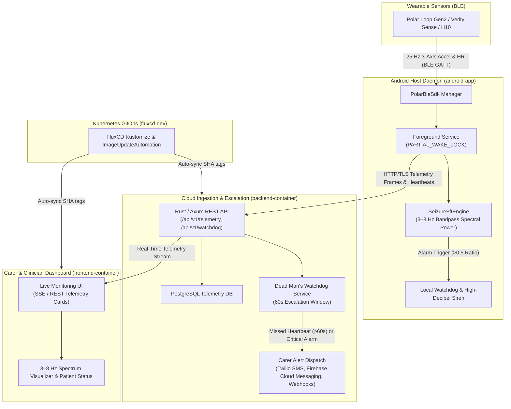
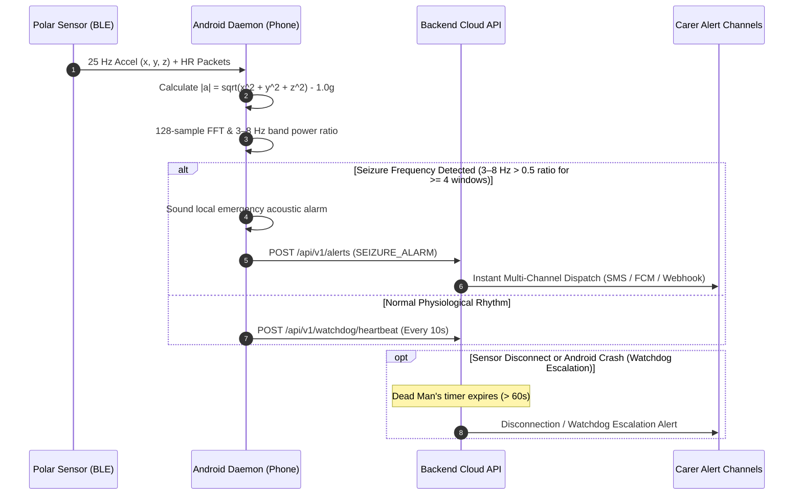

# Polar-Seizure (`ps`)

Continuous physiological and motion telemetry platform for detecting generalized tonic-clonic seizures and motor seizures using wearable BLE sensors (Polar Loop Gen2, Polar Verity Sense, Polar H10).

---

## 1. System Architecture



---

## 2. Telemetry & Escalation Sequence



---

## 3. Directory Structure

| Directory | Purpose |
|---|---|
| [`android-app/`](android-app/) | Native Kotlin Android application with Persistent Foreground Service, Polar BLE SDK, and 3–8 Hz FFT DSP engine. |
| [`backend-container/`](backend-container/) | Cloud backend microservice (Axum/Tokio/Rust) for telemetry ingestion, dead man's watchdog, and carer alert dispatch. |
| [`frontend-container/`](frontend-container/) | Responsive web dashboard (Angular/Tailwind) for carers and medical staff. |
| [`pwa-container/`](pwa-container/) | Archived reference prototype originally created on Google AI Studio. |
| [`fluxcd-dev/`](fluxcd-dev/) | Kubernetes GitOps manifests (Kustomize, HelmRelease, OCIRepository) for FluxCD. |
| [`spec/`](spec/) | Full technical specification and Product Requirement Documents ([`spec/prds/`](spec/prds/)). |
| [`.github/workflows/`](.github/workflows/) | GitHub Actions CI/CD workflows for PR testing, multi-arch Docker image packaging, and SHA-tagged Android APK compilation. |
| [`AGENTS.md`](AGENTS.md) | Architectural rules and development guidelines for AI agents and pair-programmers. |
| [`Makefile`](Makefile) | Canonical developer entry point for builds, tests, linting, and local orchestration. |

---

## 4. Developer Getting Started Guide

All builds, checks, formatting, and tests should be run via the top-level **[`Makefile`](Makefile)** targets.

### 4.1 Prerequisites
- **Git** with `pre-commit` installed (`brew install pre-commit`)
- **Rust** (stable toolchain 1.80+ with `rustfmt` and `clippy`)
- **Node.js** (v20+ or v22 LTS) and `npm`
- **Java JDK** (17 or 21) & Android SDK (API 34 / 35 platform tools)
- **Docker** & Docker Compose

### 4.2 Initial Repository Setup
```bash
# Clone the repository
git clone https://github.com/Bengreen/Polar-Seizure.git
cd Polar-Seizure

# Install pre-commit hooks (enforces secrets detection, formatting, commit checks)
make pre-commit-install

# Run all pre-commit hooks manually against the codebase
make pre-commit-run
```

### 4.3 Running & Testing Components locally

#### Backend Container (`backend-container`)
```bash
# Check code without building
make ps-be-check

# Check formatting
make ps-be-fmt

# Run backend unit & integration tests
make ps-be-test

# Run local development backend server (cleans up stale port bindings automatically)
make ps-be-dev

# Build local container image
make ps-be-docker
```

#### Frontend Container (`frontend-container`)
```bash
# Install dependencies & run test suite in headless Chrome
make ps-fe-test

# Start frontend development server on port 4200
make ps-fe-dev

# Build frontend container image with Nginx
make ps-fe-docker
```

#### Compound Commands
```bash
# Run all unit tests across all components
make test

# Build all container images and artifacts
make build
```

---

## 5. Working with AI Tooling (Google Antigravity & Pair Programming)

This repository includes operational instructions tailored for advanced agentic pair-programming workflows using Google DeepMind's **Antigravity CLI** (`agy`) and related AI systems.

### 5.1 Project-Specific AI Guidelines
Review [`AGENTS.md`](AGENTS.md) before prompting or running agents in this repository. Key requirements configured for AI agents include:
- **Safety-Critical Discipline:** Never swallow errors silently in background services, Bluetooth callbacks, or alert dispatch routines. Ambiguous telemetry must fail closed to protect patient safety.
- **Makefile as the Standard Tool Interface:** Always run tasks via `make` targets (`make ps-be-check`, `make ps-fe-test`, `make pre-commit-run`) rather than ad-hoc subsystem calls.
- **Spec-First Alignment:** Specifications and schemas reside in [`spec/prds/`](spec/prds/) and [`spec/specs/`](spec/specs/). Agents are instructed to reference PRDs before implementing changes.

### 5.2 Useful Slash Commands in Antigravity
When pair-programming with the Antigravity assistant, use these slash commands in chat:
- `/plan`: Request a step-by-step implementation plan before modifying safety-critical DSP or Bluetooth routines.
- `/pre-commit-run` or `/learn`: Verify against hooks and persist team patterns.
- `/boost`: Trigger deep reasoning and multi-perspective verification for DSP algorithm adjustments or security policies.

---

## 6. Running on an Android Phone & Debugging

The Android application (`android-app`) runs as a persistent daemon requiring runtime Bluetooth permissions and foreground execution.

### 6.1 Prerequisites for Phone Testing
1. An Android phone running **Android 10 (API 29) or higher** (Android 12+ required for granular BLE runtime permissions).
2. Developer options and **USB Debugging** enabled on your phone:
   - Go to *Settings > About Phone* and tap *Build Number* 7 times.
   - Go to *Settings > System > Developer Options* and enable *USB Debugging*.
3. Compatible Polar sensor: **Polar Loop Gen2**, **Polar Verity Sense**, or **Polar H10**.

### 6.2 Compiling & Installing the APK onto Your Device

Connect your device via USB (or pair via Wireless Debugging):

```bash
# Verify adb detects your device
adb devices

# Build and install debug APK directly
cd android-app
./gradlew installDebug

# Alternatively, build debug APK via Makefile and install using adb:
make ps-android-build
adb install -r android-app/app/build/outputs/apk/debug/app-debug.apk
```

### 6.3 Battery Optimization Exemption (Crucial for Continuous Telemetry)
To ensure Android's Doze mode does not suspend the background FFT engine:
```bash
# Whitelist app from battery optimizations via ADB
adb shell dumpsys deviceidle whitelist +org.openseizuredetector.polar
```
Or manually on the phone:
- Go to *Settings > Apps > Polar-Seizure > Battery*.
- Select **Unrestricted**.

### 6.4 Debugging Against the Device

#### Viewing Real-Time Logs via Logcat
Filter logcat specifically for Polar-Seizure service, BLE reception, and FFT calculations:
```bash
adb logcat -v time -s PolarForegroundService:V SeizureFftEngine:D PolarBleSdk:D DeadmanWatchdog:D
```

#### Simulating Seizure Accelerometer Signals via Test Scenarios
You can run automated DSP verification tests on your host without physical hardware:
```bash
# Run unit tests on Android DSP engine
cd android-app
./gradlew testDebugUnitTest --tests "org.openseizuredetector.polar.SeizureFftEngineTest"
```

#### Inspecting Bluetooth Connection & GATT Streams
```bash
# Check Bluetooth HCI snoop logs
adb shell dumpsys bluetooth_manager
```

#### Connecting the Phone App to your Local Backend
When running `make ps-be-dev` on your workstation, forward port 8080 to the connected phone:
```bash
adb reverse tcp:8080 tcp:8080
```
The phone can now send heartbeats and telemetry to `http://localhost:8080/ps`.
